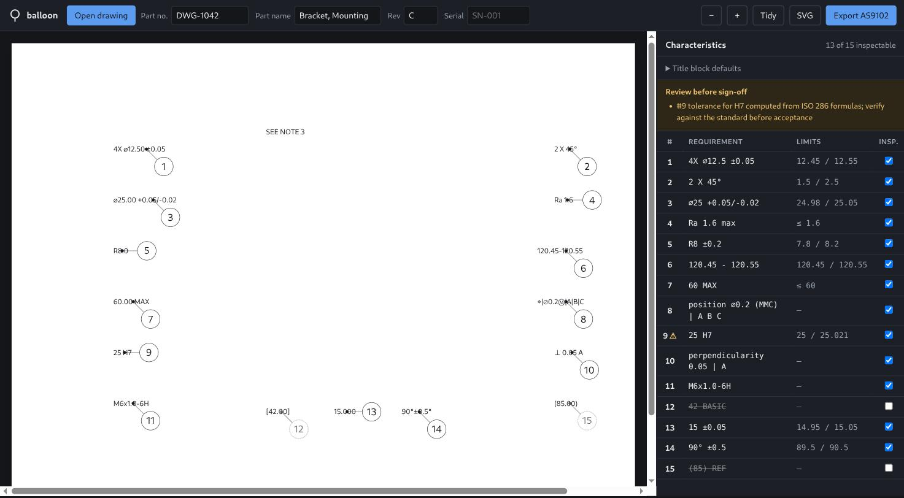

# engineering-drawing-balloon-editor

Turns an engineering drawing into a numbered inspection sheet — a browser
editor for FAI ballooning, with offline OCR and the
[engineering-drawing-balloon](https://github.com/monika1991123/engineering-drawing-balloon)
skill bundled for automatic layout.

工程图 PDF 气泡标注编辑器：打开图纸 → 本地 OCR / 文字层识别尺寸 → Skill 自动排版 →
拖动调整 → 导出标注 PDF 和 AS9102 检验表。全部在你自己的服务器上运行，不调用外部 AI。

Every machined part ships with a **First Article Inspection Report**: a table
listing each dimension on the drawing, its tolerance, and the measured value. To
build it, someone prints the drawing, hand-draws numbered bubbles ("balloons")
on every dimension, and retypes each one into a spreadsheet. Then the customer
issues revision D and they do it again.

This does the mechanical parts: read the callouts, work out what each one
actually tolerances, number them in reading order, place the balloons, and write
the AS9102 form.



Open a drawing PDF, drag balloons that landed badly, tick off what doesn't need
inspecting, export. The original PDF stays in the browser. Offline OCR sends
rendered page images to your own server; no external AI service receives them.

## Quick start

```bash
go build -o bin/balloon ./cmd/balloon
./bin/balloon serve          # then open http://localhost:8080
```

That's the whole install for text-layer PDFs. pdf.js is vendored, so there is
no npm, no build step and no network access at runtime — one Go binary with the
frontend embedded. Scanned drawings and **Skill 标注** also need the Python
environment: see [本地 OCR 与自动排版](#本地-ocr-与自动排版).

No drawing to hand? Click **Load the demo part**.

There's a CLI too, for driving the engine without a browser:

```bash
./bin/balloon parse '4X ⌀12.50 ±0.05' '25 H7' '⌖|⌀0.2Ⓜ|A|B|C'
./bin/balloon demo -o demo.svg          # render a ballooned drawing
./bin/balloon demo -o demo.svg -debug   # show text boxes and obstacle regions
go test ./...
```

## 手动标注 PDF（含无文字层的工程图）

1. 启动 `./bin/balloon serve -addr 127.0.0.1:8090`，打开 http://127.0.0.1:8090。
2. 点击 **Open drawing**，选择 PDF。没有文字层时自动进入手动添加模式。
3. 点击 **添加气泡** 开启或关闭添加模式，在尺寸位置点击，生成蓝色编号圆圈和指引线。连续点击可连续添加；按 Esc 退出添加模式。
4. 标注采用蓝色细圆圈和空心尖尾，与参考图纸风格一致。拖动圆圈调整位置；选中后拖动尖端蓝点调整指向。点击 **删除选中** 或按 Delete 删除，余下气泡自动连续编号。
5. 如需检验表，在右侧 Requirement 单元格填写真实尺寸和公差，回车后解析。未填写的手动气泡只用于图纸标注，不自动生成检验要求。
6. 点击 **导出 PDF**，下载 `原文件名-ballooned.pdf`。保留原始矢量图和全部页面，叠加蓝色气泡，不覆盖源文件。

刷新或关闭页面会丢失编辑状态，请及时导出。导出的 PDF 内嵌未标注原图和编辑数据（附件 `balloon-source.pdf`、`balloon-state.json`）；在本工具中重新打开该 PDF，会恢复为可拖动、可删除、可改编号的气泡（包括待放置项），再次导出不会叠加旧气泡。其他软件打开时仍显示正常的标注图纸；若被其他软件另存后丢失附件，则按普通 PDF 打开。旧版 Tidy / Re-read 在手工调整后禁用；“自动调整位置”根据本页已有标注排版，优先保留通过安全检查的位置，再移动冲突项与新放置项。

PDF export uses vendored [pdf-lib 1.17.1](https://pdf-lib.js.org/), MIT licensed
(see `web/vendor/LICENSE-pdf-lib`); no CDN is contacted at runtime.
Export regression check: `node --test web/balloon-pdf.test.mjs` (requires Node.js).

## 本地 OCR 与自动排版

首次部署需要 Go 1.26+、Python 3.11+，并联网下载依赖和随 wheel 提供的模型（约 500 MB 磁盘空间）。OCR 与 Skill 共用项目根目录的 `.venv`：

```bash
git clone https://github.com/monika1991123/engineering-drawing-balloon-editor
cd engineering-drawing-balloon-editor
make setup PYTHON=python3.12      # RapidOCR + PyMuPDF
go build -o bin/balloon ./cmd/balloon
./bin/balloon serve -addr 127.0.0.1:8090
```

在 Linux 服务器上，OpenCV 需要系统库 `libGL.so.1`（Amazon Linux / RHEL：`dnf install mesa-libGL`；Debian / Ubuntu：`apt install libgl1`）。服务器在远程时，用 SSH 端口转发访问，不要把端口直接暴露到公网：`ssh -L 8090:127.0.0.1:8090 user@server`。

识别使用 RapidOCR 1.4.4 附带的 PP-OCRv4 ONNX 模型，CPU 单线程执行；一次只允许一个 OCR 请求。推理时不下载模型，不调用外部 AI 接口。PNG 仅通过内存传递给本地 Python 进程，不保存到服务端磁盘。原始 PDF 继续保留在浏览器；服务器在远程时，页面图像经 SSH 隧道传到服务器。

1. 打开 PDF，点击 **本地自动标注**。逐页处理，页面文字以高清分块、四个方向（0°、90°、45°、135°）识别；已完成页面保留，失败后再次点击可重试未完成页。
2. 系统根据表格网格排除底部标题栏（包括横跨竖版图纸宽度的标题栏），过滤“Missing dimensions / Size ISO”等说明及其续行，保留旁边的粗糙度标注。标题栏整块禁止放置气泡；其余区域利用原始页面像素生成避让区域，因此 OCR 没有识别出的黑色文字和线条也能参与避让。复杂或无边框的标题栏仍需人工核对。
3. 严格排版检查气泡与原图内容的安全间距、气泡重叠、线条穿字、指引线交叉和越界。无法找到位置时，只留在右侧 **待放置** 列表，不强行画到图上。
   自动识别只保留含数字的工程标注。纯箭头、剖面字母 `A-A`、基准字母 `A` 等不显示识别框、不生成气泡；其原图像素仍参与避让。直径、半径、角度、粗糙度等带数值的标注继续保留。
4. 点击表格编号，查看原图局部、OCR 原文和其他识别结果。**识别框** 可显示所有保留的文字检测区域，包含未被当成尺寸的内容。模型得分不是正确率；所有 OCR 尺寸都标为 **待核对**。
5. **待放置 N** 表示有 N 个候选尚未画到图上，不是编号 N。点击状态栏或右侧顶部的 **待放置 N**，展开全部页面的待放置列表。点击条目会切换到对应页、滚动定位原图尺寸，并用橙框高亮；点击旁边 **放置** 可生成气泡后拖动调整。**一键放置全部** 生成全部页的待放置气泡；可能出现位置冲突，可点击 **自动调整位置** 处理本页。自动调整优先保留已通过检查的位置，无法解决的已放置项保留在原位置并提示冲突。点击 **位置冲突 N** 展开全部页冲突列表，再点击条目切换到对应页、选中并定位气泡，列表和原图预览处会显示冲突原因。也可选中后删除错误候选。
6. 核对尺寸后点击 **确认识别**；错误内容直接编辑 Requirement 并回车。OCR 不继承未经验证的默认公差。检验表默认不收录 OCR 项；确认内容后仍需明确勾选 Insp. 才收录。
7. 顶部 **气泡大小 → 统一大小** 将所有页的圆圈、编号、线宽与尖尾一起缩放，并根据已有位置调整全部页；之后新增的气泡沿用此大小。放大后仍无法避让的项目会保留冲突提示。
8. 支持直径 `Ø9.8`、半径 `R3`、数量 `4-R3` / `4-Ø4`、角度 `45°`、参考尺寸 `(Ø7.8)` 和小数逗号。选中气泡后，可在 **工程标注补正** 输入完整标注，或用 `Ø`、`R`、`°`、`±`、`()` 快捷按钮补正后点击应用。明确识别出的相邻符号会与数字合并；漏掉的符号不会根据普通数字猜测补上，仍须对照原图核对。
9. 打开 PDF 后可随时导出当前快照，无需等待识别、位置检查或冲突处理完成。原图全部页面保留，已放置标注（包括冲突项）按当前位置导出；待放置项尚未画到图上，不绘入 PDF。导出不会自动移动气泡，也不表示尺寸已核对或识别完整。
10. 点击 **一键排序**，每次根据气泡当前位置从左上到右下重新编号为 `1…N`：从上到下逐行，同一行从左到右；中心高度相差不超过当前气泡半径的标注视为同一行。多页按页码连续编号。待放置项按原图尺寸位置排序并接续在已放置项后，保证图上已有气泡的编号连续。气泡位置、尺寸内容和核对状态保持不变；图上编号、表格、待放置/冲突列表及后续导出同步更新。

此版本是辅助标注：小数点、直径符号、GD&T、上下堆叠公差及斜向尺寸仍可能误读、拆分或漏识别；不会猜测补全这些信息。避让检查以渲染图像和检测框为依据，不能作为任意 PDF 的绝对无遮挡证明。复杂封闭区域可能需要人工调整或移除候选；当前指引线为直线，不支持折线路径。

验证命令：`go test ./...`、`go vet ./...`、`make ocr-test`、`node --test web/balloon-pdf.test.mjs`。

## The interesting parts

**Callouts are a mess.** The same diameter symbol arrives as `⌀` (U+2300), `Ø`
(U+00D8), `ϕ`, or the literal string `%%c` if the drawing came out of AutoCAD.
GD&T symbols often arrive as bare ASCII letters, because the drawing used a
symbol font and the PDF text layer kept the character codes rather than the
glyphs — so a position symbol reaches you as the letter `j`.

**PDF text layers split callouts apart.** `⌀12.50` and ` ±0.05` almost always
arrive as separate runs. Hand those halves to a parser separately and you get
two useless characteristics instead of one correct one, so runs sharing a
baseline with only a small gap between them are stitched back together first.

**A dimension with no tolerance is not untoleranced.** `12.50` inherits from the
title block, and *which* default depends on how many decimal places were typed.
Parsing the number without that context produces a characteristic nobody can
measure against.

**`25 H7` carries its tolerance in a letter.** Resolving it means computing the
ISO 286 standard tolerance factor for the size band, applying the IT grade
multiplier, then positioning that width using the fundamental deviation for the
letter. The result is `+0.021 / 0`. This is implemented from the standard's
formulas and verified against published tables — and every value it produces
carries a warning, because ISO rounds its tabulated figures and a computed
acceptance limit should not be signed off without a check.

**Most of the text isn't dimensions.** Filtering on "contains a number" keeps
`SEE NOTE 3` and `SHEET 1 OF 2`. The demo ballooned the first one as a 3 mm
dimension until that was fixed.

**Placing the balloons is a constrained-optimisation problem.** A bubble should
sit near its feature, off the geometry, clear of other bubbles, with a leader
that doesn't cross another leader. On a dense drawing those goals conflict, so
the solver scores candidate positions and takes the least-bad arrangement —
weighting a balloon collision far above a long leader, because an unreadable
number is worse than an ugly one. When there is genuinely no clean answer it
still returns a position and says what's wrong with it, rather than failing or
quietly overlapping. Those balloons are tinted amber so a human knows to drag
them.

Placement is deterministic, so re-running against a revised drawing shows a
reviewer only the balloons that actually moved.

**Warnings reach the sheet, not just the screen.** Anything the pipeline could
not fully resolve is printed on the exported workbook under "Review before
sign-off". A warning that lives only in the UI is one the person signing the
report never sees.

## What it produces

An AS9102 Form 3 — *Characteristic Accountability, Verification and
Compatibility Evaluation* — with the Results column left empty for the
inspector:

```
Char. │ Ref.    │ Desig. │ Requirement          │ Acceptance Limits │ Results
──────┼─────────┼────────┼──────────────────────┼───────────────────┼────────
  1   │ Sheet 1 │        │ 4X ⌀12.5 ±0.05       │ 12.45 / 12.55     │
  2   │ Sheet 1 │        │ 2 X 45°              │ 1.5 / 2.5         │
  4   │ Sheet 1 │        │ Ra 1.6 max           │ ≤ 1.6             │
  8   │ Sheet 1 │ GD&T   │ position ⌀0.2 (MMC)  │                   │
  9   │ Sheet 1 │        │ 25 H7                │ 25 / 25.021       │
```

Requirements echo the drawing's own notation rather than a normalised rewrite,
because a customer comparing the report against the print needs to recognise
each row at a glance. Reference and basic dimensions get a balloon but no row —
they're on the drawing, they're just not measured directly.

## Layout

```
internal/dimension/   callout grammar — symbols, tolerances, threads, ISO fits, GD&T
internal/layout/      balloon placement solver and the geometry it needs
internal/model/       the pipeline: text in, numbered inspection sheet out
internal/export/      AS9102 Form 3 as XLSX
internal/render/      SVG output
internal/api/         HTTP handlers, stateless
internal/demo/        the synthetic fixture both the CLI and the browser use
web/                  frontend (vanilla JS + vendored pdf.js), embedded in the binary
cmd/balloon/          CLI: parse, demo, build, serve
```

`internal/dimension` and `internal/layout` depend on nothing else in the
project, including each other. The pipeline is the only thing that knows both
exist. The server is stateless — the browser holds the drawing and posts it back
for each operation, so there's no database and nothing left behind when you
close it.

## Known limitations

- ISO fit values are computed, not tabulated, and can differ from the published
  table by about 1 µm (`10 H7` computes 14 µm against a book value of 15). They
  are always flagged. Fundamental deviations are implemented for H, h, js, g, f,
  e and d; other letters return unresolved rather than guessing.
- The prose filter is a vocabulary allowlist. It will drop a legitimate callout
  containing an unusual abbreviation, which is the safer direction to fail but
  is still a failure.
- Leader lines initially terminate at the callout's text box centre. Drag the
  blue endpoint to point at the feature instead.
- **Offline OCR needs the optional Python environment.** Its detections require
  review; an OCR score is not an accuracy guarantee. Safe placement may leave
  crowded dimensions pending rather than covering the drawing.
- Only the first sheet is exported to SVG; the XLSX covers every sheet.

## Licence

AGPL-3.0 (see `LICENSE`), matching the bundled skill and its PyMuPDF
dependency. The editor is derived from
[dhwanikher/balloon](https://github.com/dhwanikher/balloon), MIT licensed; that
notice is kept in `LICENSE-MIT`. Vendored pdf.js is Apache 2.0 (see
`web/vendor/LICENSE-pdfjs`) and pdf-lib is MIT (see `web/vendor/LICENSE-pdf-lib`).

## Skill 标注（engineering-drawing-balloon）

点击 **Skill 标注**，调用项目内 `skill/engineering-drawing-balloon/` 的 `scripts/balloon.py` 和 `style.json` 对全部页面排版（视图分块编号、密排组、避让矢量线条）。该目录是 [engineering-drawing-balloon](https://github.com/monika1991123/engineering-drawing-balloon) 的副本，也可以单独作为 Claude Code Skill 使用。

`make setup` 已把 Skill 依赖装进项目 `.venv`。解释器优先用 `skill/engineering-drawing-balloon/.venv`（其 `scripts/setup.sh` 创建），否则用项目 `.venv`。可用环境变量 `BALLOON_SKILL_DIR` 改 Skill 目录，`BALLOON_SKILL_PYTHON` 改解释器。Skill 自测：`make skill-test`。

1. 有文字层的 PDF：把本工具已提取的尺寸连同 Skill 自己读到的文字一起排版；重叠的同一尺寸只保留一个气泡。
2. 无文字层的 PDF：先自动执行 **本地自动标注**（需上面的本地 OCR 环境），再把识别出的尺寸交给 Skill 排版。Skill 以 `--ocr off` 运行，不调用外部 AI。
3. 结果转换为普通可编辑气泡：可拖动、删除、一键排序、导出。Skill 放不下的项进入 **待放置**。Skill 自己生成的 PDF/Excel 只在临时目录中，请求结束即删除。
