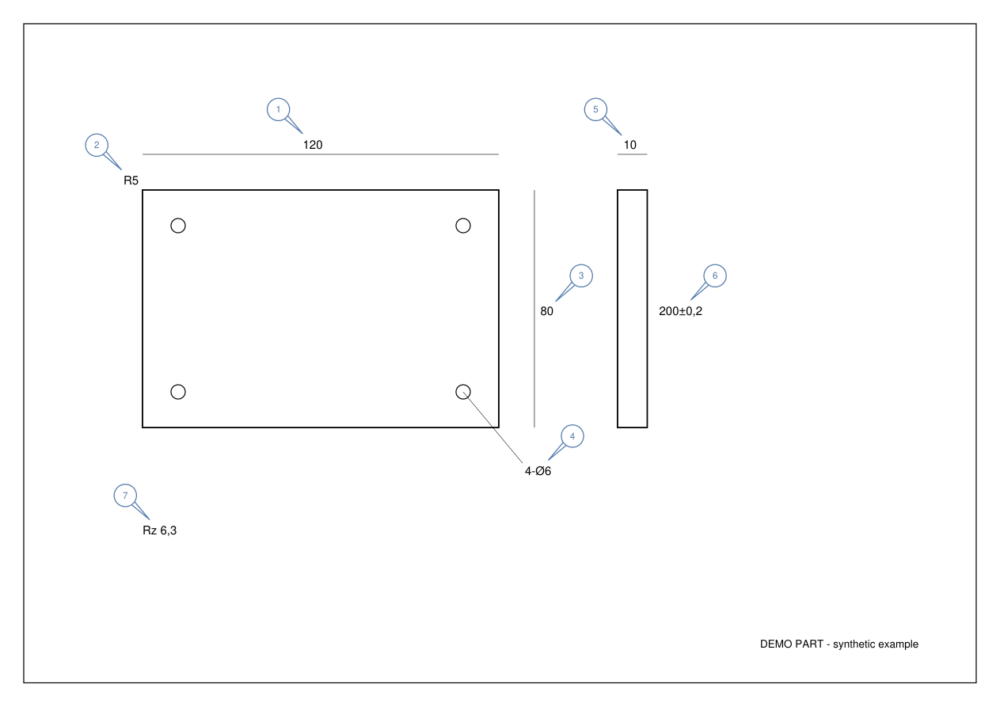

# engineering-drawing-balloon

一个 Claude Code Skill：让 AI 读工程图 PDF，识别检验特性，自动生成**蓝色气泡编号标注 PDF + Excel 检验表 + 审核报告**，用于 FAI 首件检验。

A Claude Code skill that balloons engineering drawing PDFs for first article inspection (FAI): AI reads the drawing, the bundled engine places numbered balloons and exports an inspection sheet.



## 安装（一行命令）

```bash
git clone https://github.com/monika1991123/engineering-drawing-balloon ~/.claude/skills/engineering-drawing-balloon
```

只想在某个项目里用，就克隆到项目的 `.claude/skills/engineering-drawing-balloon`。

需要 Python 3.10+。首次使用时 Claude 会运行 `scripts/setup.sh`，在 skill 目录内建 `.venv` 并安装锁定版本的 PyMuPDF；也可以手动先运行一次。

## 使用

在 Claude Code 里直接说：

> 用 engineering-drawing-balloon 标注 /path/to/drawing.pdf，输出到 /path/to/output

Claude 会：逐页看图识别尺寸、公差、螺纹、形位公差、粗糙度等 → 生成 `features.json`（坐标 + 所属视图）→ 调用引擎排版 → 回看结果并报告待复核项。

输出：

| 文件 | 内容 |
|---|---|
| `*_ballooned.pdf` | 原图 + 矢量气泡（原图内容不改动） |
| `*_inspection.xlsx` / `.csv` | 编号、页码、视图、特性、类型、状态 |
| `*_review.json` | 坐标、气泡位置、引线、统计和待复核项 |

## 排版特性

- 气泡避开文字、图框、轮廓线、尺寸线（读取 PDF 矢量线条）和像素墨迹，引线尽量少穿线
- 坐标尺寸等密排特性自动识别，交错多排排布
- 按视图分块编号，块内从左上到右下，块间连续；可用 `view_order` 指定视图顺序
- 楔形引线（默认）或直线 + 实心箭头，`style.json` 的 `leader_style` 切换
- 样式（颜色、气泡半径、引线、间距等）在 `style.json` 调整

## 不用 AI 直接跑引擎

图纸有文字层，或者你已有 `features.json` 时：

```bash
bash scripts/setup.sh
.venv/bin/python scripts/balloon.py --input examples/demo_drawing.pdf \
  --features examples/demo_features.json --style style.json --output-dir out --ocr off
```

`features.json` 格式见 [SKILL.md](SKILL.md) 和 [examples/demo_features.json](examples/demo_features.json)。

## 限制

- 识别依赖 AI 视觉；退出码 0 只表示排版完成，**交付前必须人工复核**特性是否遗漏、数值是否正确
- 旋转页面和可选 RapidOCR 路径尚无测试覆盖
- 不要把客户保密图纸提交到 issue 或 PR

## 测试

```bash
.venv/bin/python tests/test_arrow_layout.py
.venv/bin/python tests/smoke_test.py
```

## 许可证

[AGPL-3.0-only](LICENSE)。本项目依赖 [PyMuPDF](https://github.com/pymupdf/PyMuPDF)（AGPL-3.0 / 商业双许可），因此同样以 AGPL-3.0 发布。如需闭源或商用集成，请自行取得 PyMuPDF 商业许可并遵守 AGPL 义务。
